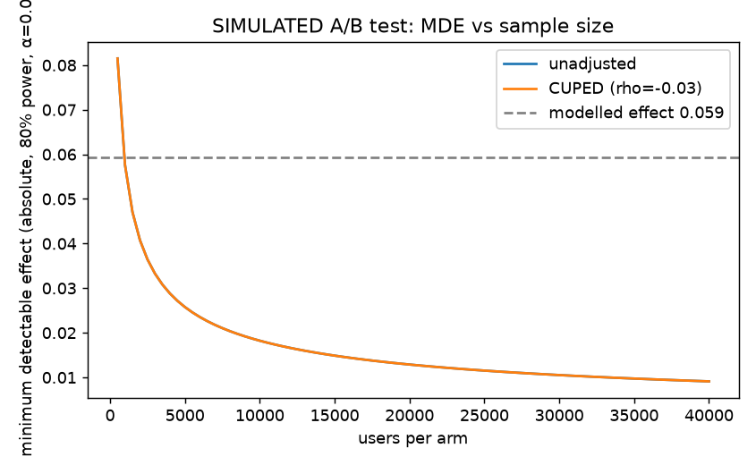

# Simulated A/B test (M6)

**This is a simulation, not an experiment.** No real users saw either system. Everything below
is generated in software from held-out MovieLens ratings under the assumptions listed here.
Code: `src/recsys/abtest.py`; tests: `tests/test_abtest.py`.

## Generative assumptions

1. **Arms.** Control = all-time popularity top-10 (unseen items). Treatment = the M4 LightGBM
   ranker's top-10 over the baseline candidates. Same 3,833 test users, same candidates.
2. **Population.** The test-split users with at least one positive. Each simulated experiment
   draws N users *with replacement* from them, then randomises exactly 50/50. The population is
   therefore small and discrete; resampling gives independent experiments but cannot create
   user types the data does not contain.
3. **Held-out signal.** A shown item is "later-liked" if the user rated it >= 4 in the test
   period. Let h be the number of later-liked items in a user's top-10 under an arm.
4. **Engagement model (assumed, not estimated).** Each shown later-liked item is clicked with
   probability 0.30, every other shown item with 0.02, independently. A user's outcome is
   whether they click at least one item: `q = 1 - 0.70^h * 0.98^(10-h)`. Outcome ~ Bernoulli(q).
   The 0.30 and 0.02 are made up; they set the *scale* of the effect, so the sample sizes below
   scale with them. The *ranking* of the arms comes from the real held-out data.
5. **Pre-period covariate.** log(1 + number of ratings the user had at the end of train), the
   same `u_n_ratings` feature the ranker uses. It is fixed before randomisation, which CUPED
   requires.
6. **No interference, no novelty effect, no position bias, no session structure, no
   non-compliance.** One outcome per user, one exposure.
7. **Peeking.** Each experiment is analysed once at its planned size. Sequential monitoring is
   out of scope.

## Methods

- Power: two-sided z-test on the difference in means, `n = 2 (z_{1-a/2} + z_{power})^2 sd^2 / delta^2`;
  CUPED multiplies the variance by `1 - rho^2`.
- Test: Welch z interval and p-value on treatment − control.
- CUPED: `y - theta (x - mean x)` with `theta = cov(x, y) / var(x)` over both arms.
- SRM: chi-square goodness of fit of arm counts against 50/50; flag at p < 0.001.
- Study: N A/A tests (treatment arm uses control probabilities) estimate the false-positive
  rate; N A/B tests at the modelled effect estimate empirical power.

## Limits

- The effect size is a product of assumption 4. Do not read it as a forecast of real lift.
- Offline hits only count items that were rated; unrated-but-good items count as misses for
  both arms.
- CUPED helps only as much as the covariate predicts the outcome (see rho below).

## Simulation results

**All numbers below are SIMULATED. No real users were randomised.**

Population: 3,833 held-out test users. Modelled effect (treatment − control mean
engagement probability): 0.0593. Outcome sd 0.460; correlation of the covariate
(log prior ratings) with the outcome ρ = -0.026, so CUPED should cut variance by about
0.1%.

Power analysis (α = 0.05, power 0.8): 946 users per arm unadjusted,
946 with CUPED.

Study: 1,000 A/A and 1,000 A/B experiments of 1,892 users each (seed 0).

| | A/A rejection rate (target 0.05) | A/B rejection rate (empirical power) | planned power | mean SE |
|---|---|---|---|---|
| unadjusted | 0.042 | 0.787 | 0.800 | 0.02115 |
| CUPED | 0.041 | 0.789 | 0.800 | 0.02114 |

Observed variance reduction from CUPED: 0.1%. SRM flags (p < 0.001) across A/A runs:
0 of 1,000. Assignment is exactly balanced in the simulation, so the check is only
exercised by unit tests that inject a skewed split.

**CUPED does nothing here.** Prior activity is essentially uncorrelated with whether a user's
top-10 contains a later-liked item (ρ ≈ 0), so the adjusted and unadjusted estimators have the
same variance. CUPED's variance reduction is demonstrated on synthetic data with a correlated
covariate in `tests/test_abtest.py` (ρ = 0.7 cuts the standard error), not on this dataset.
A covariate that predicts engagement (e.g. the user's pre-period positive rate) would be worth
trying.
